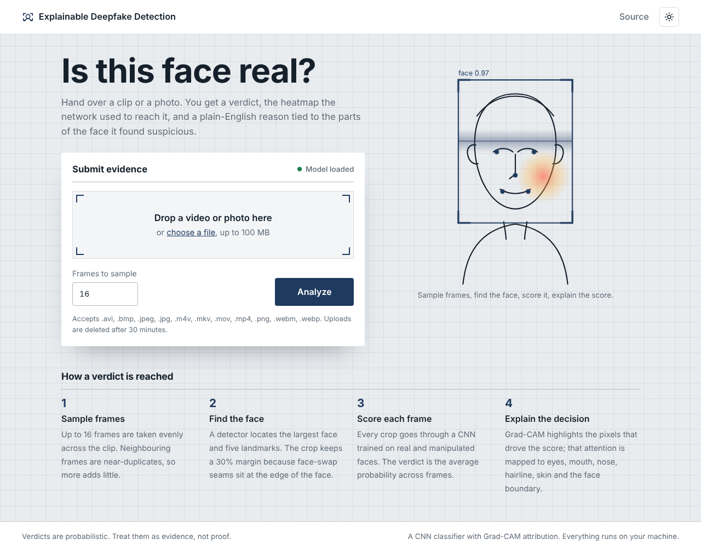
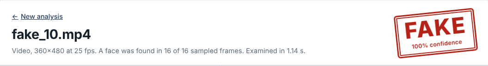
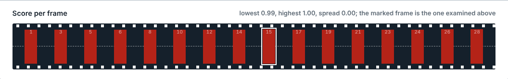
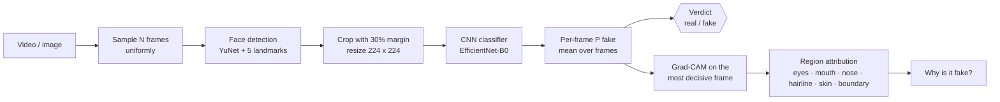
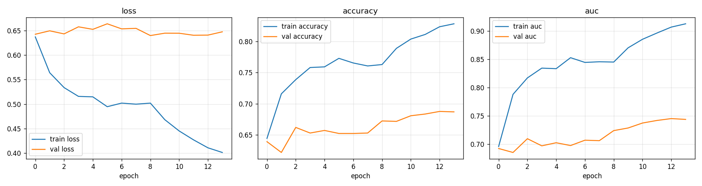
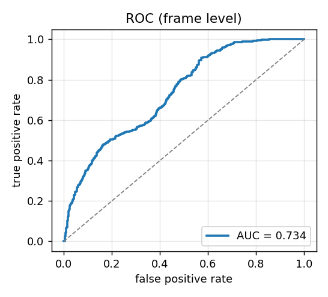
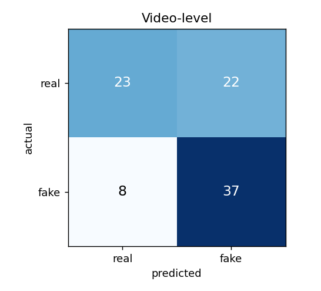

# Explainable Deepfake Detection

> Upload a video or photo → get a **real / fake** verdict → see **where** the network looked (Grad-CAM) and a plain-English reason for **why**.

   

Most deepfake detectors stop at a probability. This project adds the explanation layer: Grad-CAM shows which pixels drove the decision, and a region-attribution step maps that heat onto the eyes, mouth, nose, hairline, skin and face boundary, then reports what attention on each region usually means in a manipulated face.







---

## Pipeline



Every stage is a separate, importable module, and the web app and the CLI both call the same `DeepfakeDetector`, so they can never disagree.

## Project structure

```
Explainable-Deepfake-Detection/
├── app.py                      # Flask web demo (upload → result page, plus a JSON API)
├── predict.py                  # DeepfakeDetector class + CLI: video/image → verdict + explanation
├── prepare_dataset.py          # raw videos → face crops, split BY VIDEO, manifest.csv
├── train.py                    # two-phase transfer learning, best-by-val-AUC checkpoint
├── evaluate.py                 # frame- and video-level metrics, ROC, confusion matrices, cross-dataset
├── model_builder.py            # backbone + head definition (named sub-models for Grad-CAM)
├── config.py                   # every tunable in one place
├── requirements.txt
├── scripts/import_dataset.py   # Celeb-DF / DFDC / FF++ download folder -> data_raw/{real,fake}
│
├── preprocessing/
│   ├── face_detection.py       # YuNet (default) / Haar / none; margin + square crop; landmarks
│   └── preprocessing.py        # THE single crop → tensor function used by train and predict
├── explainability/
│   ├── gradcam.py              # Grad-CAM for Keras 3 (works on the loaded .keras file)
│   └── explain.py              # heatmap → region shares → artefact hints → summary text
├── utils/
│   ├── video_utils.py          # uniform frame sampling with seek fallback
│   └── image_utils.py          # overlays, boxes, landmarks, panels
│
├── templates/  index.html · result.html · layout.html
├── static/     css/ · js/ · uploads/ (temp) · results/ (temp)
├── notebooks/  train_colab.ipynb       # one-click GPU training on Google Colab (Kaggle download included)
│               experimentation.ipynb   # dataset checks, score histograms, Grad-CAM gallery, threshold sweep
│
├── data_raw/   real/ fake/   ← put source videos here (see data_raw/README.md)
├── dataset/    train/ validation/ test/ ← generated by prepare_dataset.py (git-ignored)
├── model/      deepfake_model.keras · class_names.json · face_detection_yunet_2023mar.onnx
└── results/    evaluation reports, plots, CLI predictions (git-ignored)
```

## Quick start

```bash
git clone https://github.com/Ishan700/Explainable-Deepfake-Detection.git
cd Explainable-Deepfake-Detection
python -m venv .venv && source .venv/bin/activate      # Windows: .venv\Scripts\activate
pip install -r requirements.txt
```

### No GPU? Train on Google Colab instead

Open [`notebooks/train_colab.ipynb`](notebooks/train_colab.ipynb) in Colab ([direct link](https://colab.research.google.com/github/Ishan700/Explainable-Deepfake-Detection/blob/main/notebooks/train_colab.ipynb)), pick a T4 GPU, upload your Kaggle API token, and run it top to bottom. It downloads Celeb-DF v2 (or the DFDC sample) from Kaggle, extracts faces, trains, evaluates, and hands you a `trained_model.zip`. Drop `deepfake_model.keras` and `class_names.json` into `model/` on your laptop and `python app.py` works. About 40 minutes end to end.

### 1. Get data

Download a dataset and let the import script sort it into `data_raw/real/` and `data_raw/fake/`:

```bash
# Celeb-DF v2 (Kaggle: reubensuju/celeb-df-v2) — 300 videos per class, balanced
python scripts/import_dataset.py --source celebdf /path/to/celeb-df-v2 --limit 300

# DFDC Kaggle sample (train_sample_videos + metadata.json)
python scripts/import_dataset.py --source dfdc /path/to/train_sample_videos --limit 200

# FaceForensics++ (after approval), c23 compression
python scripts/import_dataset.py --source ffpp /path/to/FaceForensics++ --limit 300

# Anything you sorted yourself
python scripts/import_dataset.py --source folders /path/real /path/fake
```

`data_raw/README.md` compares the datasets. For a minor project, 150–300 videos per class is plenty.

### 2. Build the face-crop dataset

```bash
python prepare_dataset.py                 # 16 frames/video, YuNet detector, 70/15/15 split
python prepare_dataset.py --frames 8 --max-videos 100   # quick experiment
```

Produces `dataset/{train,validation,test}/{real,fake}/*.jpg` and `dataset/manifest.csv` (crop → source video → split), so you can prove no video leaks across splits.

### 3. Train

```bash
python train.py                           # EfficientNet-B0, ImageNet init, 15 + 10 epochs
python train.py --architecture mobilenetv2 --epochs 8 --fine-tune-epochs 4   # CPU-friendly
```

Phase 1 trains the head on a frozen ImageNet backbone; phase 2 unfreezes the top 40 backbone layers at a 100× lower learning rate. The best checkpoint by validation AUC is saved to `model/deepfake_model.keras`, with `model/class_names.json` recording the output order and `results/training_curves.png` showing loss / accuracy / AUC.

### 4. Evaluate

```bash
python evaluate.py --gradcam-samples 6              # dataset/test
python evaluate.py --dataset /path/to/celebdf_prepared   # cross-dataset generalisation
```

Writes `results/eval_test.json` plus ROC and confusion-matrix PNGs. Both **frame-level** and **video-level** metrics are reported; video-level is what the app actually does.

### 5. Run the demo

```bash
python app.py        # → http://127.0.0.1:5000
```

Or from the terminal:

```bash
python predict.py path/to/clip.mp4
```

```
Verdict: FAKE  (confidence 93.1%, mean P(fake)=0.931, threshold 0.5)
Frames : P(fake) min 0.71 / mean 0.93 / max 0.99  (std 0.08); 16 frame(s) above threshold
Reliability: high - consistent scores across frames

Why (key frame #45, attention highly localised):
  mouth                    47.6%
  face boundary / jawline  21.3%
  cheeks & skin            14.0%

The model classified this face as FAKE with 99% confidence. Its attention is highly
localised: 48% of the Grad-CAM activation falls on the mouth and 21% on the face
boundary / jawline. Attention on the mouth usually points to lip-sync and inner-mouth
artefacts: blurred or merged teeth, inconsistent tongue, lips that lag the speech ...
```

## How the explanation works

**Grad-CAM** (Selvaraju et al.) weights the last convolutional feature maps of the backbone by the gradient of the chosen class score and collapses them into one heatmap. It is computed once per upload, on the frame that most strongly supports the verdict (highest P(fake) for a fake verdict, lowest for real), for the verdict class.

**Region attribution** (`explainability/explain.py`) upsamples the heatmap to the crop, builds disjoint masks for eight facial regions from the five YuNet landmarks (or a face template if landmarks are missing), and reports the share of heatmap mass in each. The hints attached to each region come from the deepfake-forensics literature:

| Region | Strong attention usually indicates |
|---|---|
| Eyes | inconsistent specular reflections, unnatural iris texture, irregular blinking |
| Mouth | lip-sync / inner-mouth artefacts: blurred or merged teeth, inconsistent tongue |
| Nose, cheeks | over-smoothed or mismatched skin texture, lighting that disagrees with neck/ears |
| Forehead / hairline | blending where the synthetic face meets the hair |
| Face boundary / jawline | blending seams where the swapped face meets the original frame (the classic face-swap tell) |
| Outside the face | the model is relying on compression or frame statistics, not facial evidence → verdict flagged as less trustworthy |

A **concentration** score (share of mass in the top 10% of pixels) labels the map *highly localised*, *moderately localised* or *diffuse*, and a **reliability** level (high / medium / low) is derived from how many faces were found, how much the per-frame scores disagree, and how close the mean is to the threshold.

These hints describe what attention on a region *usually* corresponds to; they are a heuristic explanation layer, not a forensic certificate.

## Design decisions worth knowing

- **Split by video, never by frame.** Frames from one clip are near-identical; a frame-level split leaks test data into training and inflates accuracy. `manifest.csv` makes the split auditable.
- **Crops keep a 30% margin.** Face-swap seams live at the border of the swapped region, often outside a tight detector box. A tight crop throws away the evidence.
- **One preprocessing function.** `preprocessing.preprocess_face` is called by both the dataset builder and inference. Crops are saved at 224×224, so Keras' resize at training time is a no-op and train/serve pixels are identical.
- **Normalisation lives inside the model.** The saved `.keras` file consumes 0–255 RGB regardless of backbone, so it cannot be fed the wrong range.
- **Class order is never assumed.** `class_names.json` is written from the dataset object; `predict.py` looks up the index of `"fake"`.
- **JPEG-recompression augmentation.** Half the training crops are re-encoded at quality 40–95 so the model learns forgery cues instead of compression fingerprints.
- **Video-level verdict.** Mean P(fake) over sampled frames, with per-frame scores shown so disagreement is visible.
- **Named sub-models.** The backbone and head are named `backbone` / `head`, which lets Grad-CAM be built from a loaded `.keras` file without the nested-graph errors Keras 3 raises when reaching into a sub-model from outside.

## Results

<!-- RESULTS:START -->
Trained on **Celeb-DF v2, 300 videos per class** with `efficientnetb0` (ImageNet init), split by video, evaluated on the held-out `test` split. Frames per video: 16. Threshold 0.5. Updated 2026-10-17.

| Level | n | Accuracy | AUC | Precision (fake) | Recall (fake) | F1 (fake) |
|---|---|---|---|---|---|---|
| Frame | 1440 | 0.652 | 0.734 | 0.615 | 0.815 | 0.701 |
| Video | 90 | 0.667 | 0.739 | 0.627 | 0.822 | 0.712 |

Video-level confusion: real→real 23, real→fake 22, fake→real 8, fake→fake 37.

AUC is the headline number: it does not depend on the 0.5 threshold, and the classes are not always balanced. The in-dataset score above is optimistic by construction; the honest check is a **cross-dataset** run (`python evaluate.py --dataset <other>`), which is usually 10–30 points lower.

**Training curves (loss / accuracy / AUC per epoch)**  


**ROC curve, frame level**  


**Confusion matrix, video level**  


<!-- RESULTS:END -->

In-dataset numbers above 0.9 AUC are routine in the literature; generalising to a different generator or compression level is the actual research problem, and reporting the drop is more valuable than hiding it.

## Configuration

All knobs are in `config.py`: `IMG_SIZE`, `FRAMES_PER_VIDEO`, `FACE_MARGIN`, `ARCHITECTURE` (`efficientnetb0` · `efficientnetb2` · `mobilenetv2` · `xception`), `GRADCAM_LAYER`, `THRESHOLD`, `MIN_FACES_FOR_VERDICT`, learning rates and epochs, `MAX_UPLOAD_MB`, `CLEANUP_AFTER_MINUTES`. Most scripts also accept the same values as CLI flags.

## JSON API

```bash
curl -F "media=@clip.mp4" -F "frames=16" http://127.0.0.1:5000/api/analyze
```

Returns the same structure as `predict.py --json`: `verdict`, `confidence`, `p_fake`, `frame_scores`, `stats`, `reliability`, `explanation` (region shares, hints, summary) and `image_urls` for the rendered panels.

## Limitations

- Trained on one dataset → accuracy drops on footage from other generators, resolutions or compression levels. Always report a cross-dataset number.
- Frame-level CNN: no temporal modelling. Flicker and audio-visual desync are invisible to it (a CNN+LSTM over the sampled frames is the natural next step).
- Splits are by *video*, not by *identity*. In Celeb-DF the same celebrities appear in real and fake clips across splits, so in-dataset numbers are slightly optimistic; the cross-dataset test is the honest check.
- Grad-CAM is coarse (7×7 for a 224 input) and shows *where*, not *why*; the region hints are heuristics.
- The web demo is a localhost tool: `static/` is public to anyone who can reach the server, and there is no authentication or rate limiting.

## References

- Selvaraju et al., *Grad-CAM: Visual Explanations from Deep Networks via Gradient-based Localization*, ICCV 2017.
- Rössler et al., *FaceForensics++: Learning to Detect Manipulated Facial Images*, ICCV 2019.
- Li et al., *Celeb-DF: A Large-scale Challenging Dataset for DeepFake Forensics*, CVPR 2020.
- Li & Lyu, *Exposing DeepFake Videos By Detecting Face Warping Artifacts*, CVPRW 2019.
- Tan & Le, *EfficientNet: Rethinking Model Scaling for Convolutional Neural Networks*, ICML 2019.
- Wu et al., *YuNet: A Tiny Millisecond-level Face Detector*, MIR 2023 — weights from [opencv_zoo](https://github.com/opencv/opencv_zoo) (Apache-2.0), bundled in `model/`.

## License

MIT — see `LICENSE`.
